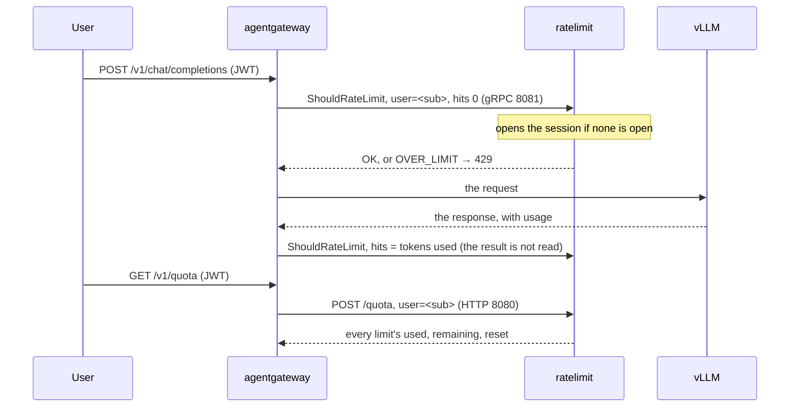

# LLM token quotas behind agentgateway

This guide puts the service behind [agentgateway](https://github.com/agentgateway/agentgateway) to give each user Claude-style quotas on a self-hosted model:

- a five-hour session that opens at the user's first message;
- a weekly budget, reset on a day of its own per user;
- a `/v1/quota` route where users read what they have left.

The standalone configuration below was run end to end with agentgateway v1.7.0 and an OpenAI-compatible backend. The Kubernetes form is translated from agentgateway's policy CRD and was not run.

## How the pieces talk



agentgateway sends two decisions per LLM request on a `tokens` descriptor:

1. **A check, before the model is called.** It is enforced: an `OVER_LIMIT` answers the user with `429`, `x-ratelimit-*` headers and `retry-after`. Its hits are the estimated input tokens, which is 0 unless agentgateway's tokenization is on, or 0 when a `cost` expression is set.
2. **An amendment, after the response.** It carries the tokens actually used, and agentgateway does not read its result. It is sent on errors and dropped streams too.

So the limits must count every hit, denied ones included, which is `overflow: envoy`, the default. The session must open on the 0-hit check, which is `open_on: check`, also the default.

## The rate limit configuration

```yaml
# $RUNTIME_ROOT/ratelimit/config/llm.yaml
domain: llm
descriptors:
  - key: user
    rate_limits:
      - name: session
        requests_per_unit: 4000000          # tokens per five-hour session
        window: {type: anchored, duration: 5h}
      - name: weekly
        requests_per_unit: 40000000         # tokens per week
        window: {type: fixed, duration: 7d, offset: hashed}
```

Each value of `user` gets its own session and its own weekly window ([configuration](configuration.md#windows)). Run the service with Redis, since `anchored` windows need it. Set `RUNTIME_WATCH_ROOT=false` so that edits to the file, or a Kubernetes ConfigMap update, are reloaded:

```sh
RUNTIME_SUBDIRECTORY=ratelimit RUNTIME_WATCH_ROOT=false USE_STATSD=false \
REDIS_SOCKET_TYPE=tcp REDIS_URL=redis:6379 /bin/ratelimit
```

To also cap a whole workspace, add a second descriptor (`key: workspace`) with its own `rate_limits:`, and a second descriptor on the agentgateway side. A request is then denied when either one is over.

## agentgateway, standalone

```yaml
llm:
  port: 4000
  policies:
    jwtAuth:
      mode: strict                          # the default, optional, lets requests without a token through
      issuer: https://issuer.example
      audiences: [llm]
      jwks:
        url: https://issuer.example/.well-known/jwks.json
    remoteRateLimit:
      domain: llm
      host: ratelimit:8081                  # gRPC
      descriptors:
      - entries:
        - key: user
          value: jwt.sub                    # CEL: the JWT's subject
        type: tokens                        # amended with llm.totalTokens after the response
  models:
  - name: qwen3
    provider:
      custom:
        formats:
        - type: completions
    params:
      baseUrl: http://vllm:8000/v1
      model: Qwen/Qwen3-32B
binds:
- port: 3000
  listeners:
  - protocol: HTTP
    routes:
    - matches:
      - path:
          exact: /v1/quota
      policies:
        jwtAuth:
          mode: strict
          issuer: https://issuer.example
          audiences: [llm]
          jwks:
            url: https://issuer.example/.well-known/jwks.json
        transformations:
          request:
            set:
              ":method": '"POST"'
              ":path": '"/quota"'
              content-type: '"application/json"'
            body: '{"domain": "llm", "descriptors": [{"entries": [{"key": "user", "value": jwt.sub}]}]}'
      backends:
      - host: ratelimit:8080                # HTTP
```

- **The `/v1/quota` route's descriptors** must match the ones `remoteRateLimit` sends: the same domain, the same keys, and the values from the same claims. Otherwise the lookup reports on other limits ([why](quota-lookup.md#request)).
- **`failureMode`** defaults to `failClosed`, so requests fail while the service is unreachable. Set `failureMode: failOpen` to let them through instead.
- **A descriptor whose CEL fails is skipped.** If, for example, the token has no `sub`, that request goes unlimited.
- **Negative amendments are not sent.** When agentgateway's tokenization estimates more input tokens than were used, the difference stays counted.

## agentgateway on Kubernetes

The same rate limit, as an `AgentgatewayPolicy`. In this form, an entry is `name` and `expression`, and the descriptor's type is `unit: Tokens`:

```yaml
apiVersion: agentgateway.dev/v1alpha1
kind: AgentgatewayPolicy
metadata:
  name: llm-quotas
spec:
  targetRefs:
    - group: gateway.networking.k8s.io
      kind: Gateway
      name: llm
  traffic:
    rateLimit:
      global:
        backendRef:
          name: ratelimit
          port: 8081
        domain: llm
        descriptors:
          - entries:
              - name: user
                expression: jwt.sub
            unit: Tokens
```

## What users see

`GET /v1/quota` with the user's token:

```json
{"descriptors":[{"limits":[
  {"limit":4000000,"name":"session","open":true,"quota_mode":false,"remaining":2400000,"resets_at":"2026-10-28T16:05:00Z","resets_in_s":7500,"shadow_mode":false,"used":1600000,"used_pct":40.0,"window":{"duration_s":18000,"type":"anchored"}},
  {"limit":40000000,"name":"weekly","quota_mode":false,"remaining":15200000,"resets_at":"2026-11-02T10:00:00Z","resets_in_s":417600,"shadow_mode":false,"used":24800000,"used_pct":62.0,"window":{"duration_s":604800,"type":"fixed"}}]}],
 "now":"2026-10-28T14:00:00Z"}
```

A client shows it as "Session 40 % · resets in 2 h 05 · Week 62 % · resets Monday 10:00":

- **Percentages:** use `used_pct`. The raw token counts need not be shown.
- **Before the first message:** the session has `open: false` and no reset time.
- **Over 100 %:** `used_pct` can pass 100, because the amendment of the last request is counted even when it overshoots. The next request is then denied until `resets_at`.
- **Polling:** poll about once a minute.

Over the limit, the chat request itself answers `429`, with `retry-after` set to the seconds left before the exhausted limit resets (if both are, the later of the two).
