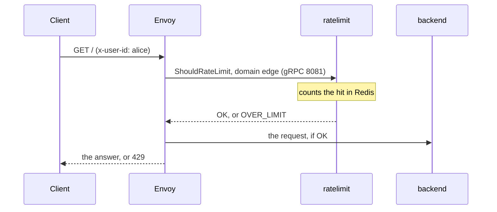

# Example: rate limiting with Envoy

This example puts the service behind [Envoy](https://www.envoyproxy.io/)'s global rate limit filter, `envoy.filters.http.ratelimit`. For each request, Envoy turns the route's `rate_limits` actions into descriptors and asks the service over gRPC. When the service answers `OVER_LIMIT`, Envoy replies `429 Too Many Requests` without calling the backend.

The example sets three limits:

- every request on the route, all clients together: 100 a second;
- per user (the `x-user-id` header): 3 requests a minute **and** 20 an hour, two named limits on one descriptor (`rate_limits:`, not in upstream);
- per user, `DELETE` requests: 1 a minute.

It is adapted from upstream's `examples/envoy/proxy.yaml` and integration test. The configuration and the answers below were run with Envoy 1.40.2 and this service, with the host names set to `127.0.0.1`. The Compose file itself was not run.

## How the pieces talk



## Files

```text
envoy-example/
├── compose.yaml
├── envoy.yaml
└── ratelimit/config/edge.yaml
```

### The limits: `ratelimit/config/edge.yaml`

```yaml
domain: edge
descriptors:
  # Every request on the route, all clients together: 100 a second.
  - key: generic_key
    value: api
    rate_limit:
      unit: second
      requests_per_unit: 100

  # Per user (the x-user-id header): 3 requests a minute and 20 an hour.
  - key: user
    rate_limits:
      - name: minute
        requests_per_unit: 3
        window: {type: fixed, duration: 1m}
      - name: hour
        requests_per_unit: 20
        window: {type: fixed, duration: 1h}
    descriptors:
      # Per user, DELETE requests: 1 a minute.
      - key: method
        value: DELETE
        rate_limit:
          unit: minute
          requests_per_unit: 1
```

- `key: user` has no `value`, so each user gets their own counters.
- A request matches a limit only when its descriptor has exactly that depth. `(user=bob, method=GET)` matches no limit: `user` alone is one level, and only `DELETE` is configured at the second.
- The YAML format is in [configuration.md](../configuration.md).

### Envoy: `envoy.yaml`

```yaml
static_resources:
  listeners:
    - name: ingress
      address:
        socket_address: {address: 0.0.0.0, port_value: 8888}
      filter_chains:
        - filters:
            - name: envoy.filters.network.http_connection_manager
              typed_config:
                "@type": type.googleapis.com/envoy.extensions.filters.network.http_connection_manager.v3.HttpConnectionManager
                stat_prefix: ingress
                http_filters:
                  - name: envoy.filters.http.ratelimit
                    typed_config:
                      "@type": type.googleapis.com/envoy.extensions.filters.http.ratelimit.v3.RateLimit
                      domain: edge                 # the YAML's domain
                      failure_mode_deny: false     # let requests through if the service is down
                      enable_x_ratelimit_headers: DRAFT_VERSION_03
                      rate_limit_service:
                        transport_api_version: V3
                        grpc_service:
                          envoy_grpc: {cluster_name: ratelimit}
                  - name: envoy.filters.http.router
                    typed_config:
                      "@type": type.googleapis.com/envoy.extensions.filters.http.router.v3.Router
                route_config:
                  name: local
                  virtual_hosts:
                    - name: backend
                      domains: ["*"]
                      routes:
                        - match: {prefix: /}
                          route:
                            cluster: backend
                            rate_limits:
                              # (generic_key=api)
                              - actions:
                                  - generic_key: {descriptor_value: api}
                              # (user=<x-user-id>), only when the header is present
                              - actions:
                                  - request_headers: {header_name: x-user-id, descriptor_key: user}
                              # (user=<x-user-id>, method=<the HTTP method>)
                              - actions:
                                  - request_headers: {header_name: x-user-id, descriptor_key: user}
                                  - request_headers: {header_name: ":method", descriptor_key: method}
  clusters:
    - name: ratelimit
      type: STRICT_DNS
      connect_timeout: 1s
      typed_extension_protocol_options:
        envoy.extensions.upstreams.http.v3.HttpProtocolOptions:
          "@type": type.googleapis.com/envoy.extensions.upstreams.http.v3.HttpProtocolOptions
          explicit_http_config:
            http2_protocol_options: {}   # gRPC needs HTTP/2
      load_assignment:
        cluster_name: ratelimit
        endpoints:
          - lb_endpoints:
              - endpoint:
                  address:
                    socket_address: {address: ratelimit, port_value: 8081}
    - name: backend
      type: STRICT_DNS
      connect_timeout: 1s
      load_assignment:
        cluster_name: backend
        endpoints:
          - lb_endpoints:
              - endpoint:
                  address:
                    socket_address: {address: backend, port_value: 3000}
```

Each entry of `rate_limits` produces one descriptor; Envoy sends them all in one call. If an action cannot produce its entry (here, a request without `x-user-id`), that descriptor is not sent, and the others still are.

Envoy's filter waits 20 ms for the answer by default (`timeout`). Past that, or when the service is unreachable, `failure_mode_deny: false` lets the request through.

### `compose.yaml`

```yaml
services:
  redis:
    image: redis:8
    command: ["redis-server", "--save", ""]

  ratelimit:
    image: ghcr.io/ayrickk/ratelimit:0.1.0
    depends_on: [redis]
    environment:
      RUNTIME_SUBDIRECTORY: ratelimit
      RUNTIME_WATCH_ROOT: "false"    # reload when edge.yaml is edited
      REDIS_SOCKET_TYPE: tcp
      REDIS_URL: redis:6379
      USE_STATSD: "false"
      USE_PROMETHEUS: "true"         # metrics on :9090/metrics
    volumes:
      - ./ratelimit/config:/srv/runtime_data/current/ratelimit/config:ro
    ports:
      - "6070:6070"                  # debug port: /rlconfig
      - "9090:9090"

  backend:
    image: registry.k8s.io/gateway-api/echo-basic:v1.5.1

  envoy:
    image: envoyproxy/envoy:v1.40-latest
    depends_on: [ratelimit, backend]
    command: ["envoy", "-c", "/etc/envoy/envoy.yaml"]
    volumes:
      - ./envoy.yaml:/etc/envoy/envoy.yaml:ro
    ports:
      - "8888:8888"
```

```sh
docker compose up -d
curl -s localhost:6070/rlconfig
```

`/rlconfig` shows the limits the service loaded, a line per limit:

```text
edge.generic_key_api: unit=SECOND requests_per_unit=100, shadow_mode: false, quota_mode: false
edge.user~minute: window=fixed 60s requests_per_unit=3, shadow_mode: false, quota_mode: false
edge.user~hour: window=fixed 3600s requests_per_unit=20, shadow_mode: false, quota_mode: false
edge.user.method_DELETE: unit=MINUTE requests_per_unit=1, shadow_mode: false, quota_mode: false
```

## Trying it

Four requests from the same user within a minute; the fourth is over `minute`'s 3:

```sh
for i in 1 2 3 4; do
  curl -s -o /dev/null -w '%{http_code}\n' -H 'x-user-id: alice' localhost:8888/
done
```
```text
200
200
200
429
```

Two `DELETE` requests from another user; the second is over 1 a minute:

```sh
for i in 1 2; do
  curl -s -o /dev/null -w '%{http_code}\n' -X DELETE -H 'x-user-id: bob' localhost:8888/
done
```
```text
200
429
```

To see the headers Envoy adds (from `enable_x_ratelimit_headers`), for a user's first request:

```sh
curl -si -H 'x-user-id: carol' localhost:8888/ | grep -i '^x-ratelimit'
```
```text
x-ratelimit-limit: 3, 100;w=1, 3;w=60;name="minute"
x-ratelimit-remaining: 2
x-ratelimit-reset: 20
```

The most limiting status comes first, then each descriptor's limit with its window in seconds, and the name of a list limit.

### The same decisions without Envoy

The service's `/json` endpoint, on its HTTP port 8080, takes the same descriptors as Envoy's gRPC call. Publish port 8080 in `compose.yaml`, then send what Envoy sends for a `GET` from alice, four times:

```sh
for i in 1 2 3 4; do
  curl -s localhost:8080/json -d '{"domain":"edge","descriptors":[
    {"entries":[{"key":"generic_key","value":"api"}]},
    {"entries":[{"key":"user","value":"alice"}]},
    {"entries":[{"key":"user","value":"alice"},{"key":"method","value":"GET"}]}]}'
  echo
done
```

Each answer has one status per descriptor, and the HTTP status is 429 when one is over. In the fourth, the second status is `OVER_LIMIT` and names the limit that decided, `minute`; the third descriptor matches no limit. The remaining counts and resets depend on when you run it:

```json
{"overallCode":"OVER_LIMIT","statuses":[
  {"code":"OK","currentLimit":{"requestsPerUnit":100,"unit":"SECOND"},"limitRemaining":96,"durationUntilReset":"1s"},
  {"code":"OVER_LIMIT","currentLimit":{"name":"minute","requestsPerUnit":3,"unit":"MINUTE"},"durationUntilReset":"54s"},
  {"code":"OK"}]}
```

The endpoint and its fields are in [api.md](../api.md). Every decision counts hits, so these calls count like Envoy's.

## What to change for production

- **Redis:** point `REDIS_URL` at a managed or replicated Redis; see [backends.md](../backends.md).
- **Configuration reloads:** keep `RUNTIME_WATCH_ROOT=false` for a mounted directory or a Kubernetes ConfigMap, and add `RUNTIME_IGNOREDOTFILES=true` for a ConfigMap ([deployment.md](../deployment.md#kubernetes)).
- **Metrics:** each limit has its own stats, `ratelimit.service.rate_limit.edge.user~minute.over_limit` for example; see [observability.md](../observability.md).
- **Failure mode:** `failure_mode_deny: true` refuses requests (Envoy answers 500) when the service cannot answer in time.
